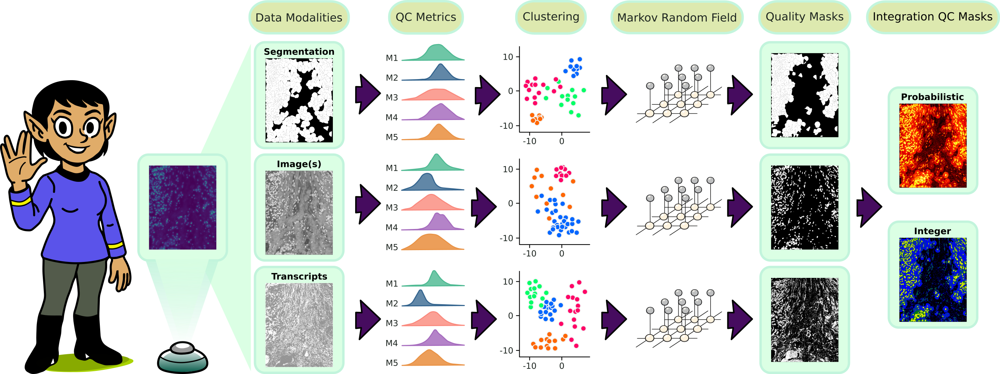
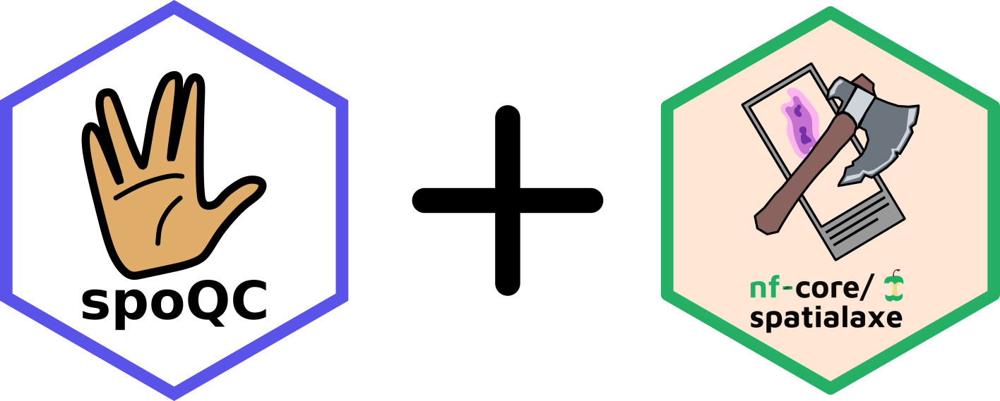

# spoQC

[](https://github.com/heylf/spoQC_beta/actions/workflows/ci.yml)
[](https://pypi.org/project/spoqc/)
[](https://www.docker.com/)
[](https://sylabs.io/docs/)
[](https://nfcore.slack.com/channels/spatialaxe)



<div style="height: 20px;"></div>

spoQC is a modular framework for multimodal quality control (QC) of imaging-based spatially resolved transcriptomics (SRT). It independently evaluates cell segmentation, imaging, and transcript data to identify high-quality regions (HQRs) across entire tissue sections. In addition, spoQC uses Markov random fields (MRFs) to incorporate spatial dependencies and generate spatially refined QC masks.

> [!NOTE]
SpoQC is currently under active development and is still in the alpha phase. You may encounter bugs, incomplete features, or unexpected behavior. If you are testing spoQC and run into any issues, please contact the development team or open an issue in the repository. Feedback, bug reports, and pull requests are highly appreciated and help us improve the project.

> [!NOTE]
Processing a full-resolution spatial transcriptomics (SRT) dataset with spoQC typically requires access to an HPC (High Performance Computing) environment. For smaller datasets, reduced-resolution data, or data subsets, it may be possible to run spoQC locally.



To reduce runtime and improve scalability, we recommend running spoQC with Nextflow. We are continuously working on improving performance and making local execution easier.

# Supported Spatial Transcriptomics Technologies

Currently supported:

- 10x Xenium (XOA v4.0 or lower)

> [!NOTE]
Atera support is currently under development and is not yet available.

# Cite

If you use spoQC in your work, please cite:

```
@software{spoqc,
  author  = {Heyl, Florian and
             Sen, Ezgi and
             Müller-Bötticher, Niklas and
             Kher, Sameesh and
             He, Dongze and
             Long, Brian and
             Ishaque, Naveed and
             Stegle, Oliver},
  title   = {spoQC},
  url     = {https://bio.tools/spoqc},
  note    = {bio.tools identifier: biotools:spoqc},
  urldate = {2026-08-17}
}
```

# Collaborators

This tool was developed in collaboration with the following institutions:

- German Cancer Research Center (DKFZ, Heidelberg, Germany)
- Centro Nacional de Análisis Genómico (CNAG, Barcelona, Spain)
- Center for Quantitative Analysis of Molecular and Cellular Biosystems (BioQuant, Heidelberg, Germany)
- Berlin Institute of Health at Charité (Berlin, Germany)
- Altos Labs San Diego Institute of Technology (San Diego, USA)
- Allen Institute for Brain Science (Seattle, USA)
- European Molecular Biology Laboratory (EMBL, Heidelberg, Germany)

# Contributors

The following people contributed directly or indirectly through supervision, code review, and the development of concepts and ideas:

- Florian Heyl
- Ezgi Sen
- Niklas Müller-Bötticher
- Sameesh Kher
- Dongze He
- Brian Long
- Naveed Ishaque
- Oliver Stegle

# Documentation

For further details please read the [documentation](https://spoqc.readthedocs.io/en/latest/).


# Installation

## Pip

```
pip install spoqc
```

Once istalled, run spoQC exactly as described in [Run](#run).

## Docker

spoQC also provides a prebuilt Docker image (`quay.io/heylf/spoqc:0.1.0`) on Quay.io with all
dependencies already installed. This is useful if you do not want to set up a local Python
environment.

### Using the Docker container

Start a container and drop into a shell, bind-mounting the directory that holds your data so the
container can read and write it:

```
docker run -ti -v /path/to/data:/data quay.io/heylf/spoqc:0.1.0 bash
```

Once inside the container, run spoQC exactly as described in [Run](#run), for example:

```
python3 -m spoqc -s all -i [input_spatial_data_bundle] -o [output_folder] -t [spoqc_tmp_folder] -n [n_cores] -a [annotation_file]
```

### Using Singularity / Apptainer

Many HPC clusters do not allow running Docker directly, but support Singularity or Apptainer instead. Both can pull and run Docker images directly, so you can use the same spoQC image on such systems.

Pull the Docker image and convert it to a Singularity image file:

```
singularity pull spoqc.sif docker://quay.io/heylf/spoqc:0.1.0
```

Then run spoQC through the image, bind-mounting your data directory:

```
singularity exec -B /path/to/data:/data spoqc.sif \
    python3 -m spoqc -s all -i [input_spatial_data_bundle] -o [output_folder] -t [spoqc_tmp_folder] -n [n_cores] -a [annotation_file]
```

On clusters using the newer Apptainer branding, `apptainer` is a drop-in replacement for
`singularity`, thus the same commands work by substituting `apptainer` for `singularity`.

# Run

spoQC is designed to process large spatial transcriptomics (SRT) datasets at full resolution. Running the complete pipeline typically requires access to an HPC (High Performance Computing) environment.

If you do not have access to an HPC system, you may still be able to run spoQC locally by:

- Using a lower-resolution dataset.
- Running spoQC on a subset of your data.
- Testing individual pipeline steps before processing the full dataset.

## Step 1: Generate a Cell Type Annotation (Optional)

If your dataset does not already contain a cell type annotation, spoQC can create one automatically using unsupervised Leiden clustering.

Run:

```bash
python3 -m spoqc -s "annotation" -i [input_spatial_data_bundle] -o [output_folder] -t [spoqc_tmp_folder] -n [n_cores]
```

After the analysis finishes, spoQC will create an annotation file:

```text
[output_folder]/report/annotation/unsupervised_cell_annotation.tsv
```

You can use this file as the value for the `[annotation_file]` parameter in later steps.

---

## Step 2: Run the Complete spoQC Pipeline

To execute all spoQC analyses in the correct order, run:

```bash
python3 -m spoqc -s all -i [input_spatial_data_bundle] -o [output_folder] -t [spoqc_tmp_folder] -n [n_cores] -a [annotation_file]
```

This is the recommended option for most users.

---

## Options

spoQC uses a [rich-click](https://github.com/ewels/rich-click) command line interface. To list all options with their defaults, run:

```bash
python3 -m spoqc --help
```

### Required

| Option | Description |
|---|---|
| `-i`, `--input_file` | Path to the input SpatialData bundle (see [Input](input.md)). |
| `-o`, `--output_dir` | Output directory. spoQC writes all results to `[output_dir]/report/`. |
| `-t`, `--tmp_dir` | Directory for temporary files (see [Output temporary data files](output_tmp.md)). |
| `-s`, `--step` | Step to run (default: `all`). |
| `-d`, `--datatype` | Type of the input data (default: `xenium`). Currently only `xenium` is supported. |

### Optional

| Option | Default | Description |
|---|---|---|
| `-a`, `--annotation_file` | – | Cell type annotation file (see [Input](input.md)). Required for the `analysis_*` steps. |
| `-n`, `--nthreads` | `1` | Number of cores. |
| `--staining` | `0` | Integer index of the staining used for the HQPR steps. The mapping of indices to staining names is written to `report/staining_log.txt`. |
| `--cellcycle_gene_file` | – | JSON file with `"S"` and `"G2M"` keys listing the S-phase and G2M-phase genes. |
| `--cluster_celltype` | – | Name of a cell type you want to analyse specifically. |
| `--reference_file` | – | Transcript reference file for the transcript QC. |
| `--overwrite` | off | Overwrite existing temporary files. |
| `--doublet_prior_std` | `0.125` | Standard deviation of the doublet prior. Increasing it increases the impact of doublet events, i.e., doublet events affect more cells and give them a lower quality. |
| `--doublet_prior_mean` | estimated | Mean of the doublet prior. By default it is estimated automatically from the data, but it can be set manually. |
| `--thresh_prior_pixel` | estimated | Threshold for the pixel score prior distribution (HQPR/HQTR). Only set this if you understand the pixel prior (see [Image metrics](metrics_image_layer.md)). |
| `--nstds_prior_pixel` | `6` | Number of standard deviations for the pixel score prior distribution (HQPR/HQTR). |
| `--kmeans_sample_size` | `5000000` | Number of randomly subsampled pixels used to fit the MiniBatchKMeans model of the pixel clustering (HQPR/HQTR). All pixels are then labeled in parallel with the fitted model. |
| `--chunk_size` | `200000` | Row-chunk size of the dask arrays/dataframes for the HQPR/HQTR clustering and scoring. Larger values reduce dask overhead but increase the peak memory per chunk. |

> [!NOTE]
The defaults of `--kmeans_sample_size` and `--chunk_size` usually do not have to be changed.

---

## (Run Individual Pipeline Steps)

Advanced users can execute individual spoQC steps separately.

Run:

```bash
python3 -m spoqc -s [step] -i [input_spatial_data_bundle] -o [output_folder] -t [spoqc_tmp_folder] -n [n_cores] -a [annotation_file]
```

Replace `[step]` with one of the following pipeline stages.

> **Important:** These steps must be executed in the exact order shown below. Running steps out of order will cause downstream analyses to fail.

| # | Step | What it does |
|---|---|---|
| 1 | generalqc | General single cell metrics (transcript, gene and control probe counts) and the check for invalid cell/nucleus geometries. |
| 2 | doubletqc | Doublet detection with [ovrl.py](https://github.com/HiDiHlabs/ovrl.py) and the cell overlap area. |
| 3 | voidqc | Unassigned transcripts (uRNAs) within the convex hull of each cell. |
| 4 | cellqc | Cell shape and neighbourhood metrics: border score, thinness (bubble) score, convexity, island score, nuclei count and low quality transcripts. |
| 5 | ambientqc | Global Moran's *I* per gene, needed for the ambient RNA (AC) image in `hqtr_ac`. |
| 6 | hqcr_ident | Calculates and combines the HQCR priors (incl. the cell traffic light system) and identifies HQCRs. |
| 7 | hqcr_celltype | Cell type refinement of the HQCR mask. |
| 8 | hqpr_metrices | Image metrics for one staining (has to be run for each staining). |
| 9 | hqpr_clustering | Pixel clustering and HQPR priors (has to be run for each staining). |
| 10 | hqpr_refinement | Markov random field smoothing of the HQPR mask (has to be run for each staining). |
| 11 | hqpr_bounding_box | HQPR bounding boxes (has to be run for each staining). |
| 12 | hqpr_celltype | Cell type analysis of the HQPR (has to be run for each staining). |
| 13 | hqtr_metrices | Transcript density image and its image metrics. |
| 14 | hqtr_ac | Ambient RNA (autocorrelation) image. |
| 15 | hqtr_qv | Transcript quality (QV) image. |
| 16 | hqtr_clustering | Pixel clustering and HQTR priors. |
| 17 | hqtr_refinement | Markov random field smoothing of the HQTR mask. |
| 18 | hqtr_bounding_box | HQTR bounding boxes. |
| 19 | hqtr_celltype | Cell type analysis of the HQTR. |
| 20 | combine_masks | Combines the HQCR, HQPR and HQTR masks (has to be run for each staining). |
| 21 | transcriptqc | Transcript QC (optionally against `--reference_file`). |
| 22 | modelqc | QC model analysis. |
| 23 | cellcycleqc | Cell cycle QC. |
| 24 | whole_slide_qc | Whole slide QC plots. |
| 25 | analysis_overview | Overview analysis (requires `-a`). |
| 26 | analysis_cluster | Subcluster analysis (requires `-a`). |
| 27 | analysis_category | Category analysis (requires `-a`). |
| 28 | final_report | Builds `report.html`. |

The following steps are not part of `all` and can be run additionally:

- `annotation`: unsupervised cell type annotation (see Step 1).
- `markerqc`: marker gene QC.
- `combine_masks_zoom`: zoomed-in plots of the combined masks.

### Example

To run the first pipeline step (`generalqc`), execute:

```bash
python3 -m spoqc -s generalqc -i [input_spatial_data_bundle] -o [output_folder] -t [spoqc_tmp_folder] -n [n_cores] -a [annotation_file]
```

Wait until the step has completed successfully before continuing with the next step in the list.

# Nextflow subworkflow


spoQC can be executed sequentially, but processing a full-resolution spatial transcriptomics dataset typically takes **4–5 days** to complete.

To significantly reduce runtime, we provide a dedicated Nextflow subworkflow that parallelizes many of the processing steps. Using the Nextflow workflow can reduce the total runtime to approximately **~1 day**, depending on the available computational resources.

The workflow is available on the **dev branch** of [nf-core/spatialaxe](https://github.com/nf-core/spatialaxe/tree/dev).

> [!NOTE]
Processing a full-resolution spatial transcriptomics (SRT) dataset with spoQC typically requires access to an HPC (High Performance Computing) environment.

If an HPC system is not available, you may still be able to run spoQC locally by:

- Using a lower-resolution dataset.
- Processing a subset of your data.
- Running selected workflow components instead of the complete pipeline.

# Contribute

There are several ways to contribute to spoQC. Since version 0.1.0 spoQC is object oriented, so that new metrics and priors can be added without touching the rest of the pipeline. The project is built around four main pillars:

- metrics (`spoqc/metrics/`)
- priors (`spoqc/priors/`)
- missions (`spoqc/missions/`, formerly called `subworkflows`)
- the core framework and standard pre- and postprocessing scripts (`spoqc/core/`, `spoqc/general/`, `spoqc/helperfuncs.py`)

## Code structure

### `spoqc/core/`

The core classes that connect all parts of spoQC:

| File | Content |
|---|---|
| `starship.py` | `Enterpise`, the central object of a run. It holds the parsed arguments (`enterprise.args`), the data (`enterprise.cargo`), the metric sets, the prior sets and the HQR sets. It is passed to every metric, prior and mission. |
| `_config.py` | `Args`, the parsed command line options and fixed parameters (e.g., seed, image type, resolution). |
| `_data.py` | `CargoSpatialData`, which loads the SpatialData object (`enterprise.cargo.sdata`) and performs the standard data processing. |
| `metric.py` | `Metric` and `MetricSet`. |
| `prior.py` | `Prior` and `PriorSet`, including the prior combination methods. |
| `hqr.py` | `HqcrSet`, `HqprSet` and `HqtrSet`, which collect the metrics used for the HQCR, HQPR and HQTR analysis. |
| `_output_structure.py` | Creates the output folder structure for each step. |

### `spoqc/metrics/`

Metrics quantify different aspects of spatial transcriptomics data quality. They are organized by the high quality region (HQR) they belong to:

- `spoqc/metrics/hqcr/`: segmentation (cell) metrics, e.g., `convexity.py`, `doublet_score.py`
- `spoqc/metrics/hqpr/`: image (staining) metrics, e.g., `edge_strength.py`
- `spoqc/metrics/hqtr/`: transcript (density) metrics, e.g., `qv_image.py`, `ac_image.py`

### `spoqc/priors/`

Priors estimate the probability that a spatial observation (a cell or a pixel) is of **high quality** based on one or several metrics. They are organized in the same way as the metrics:

- `spoqc/priors/hqcr/`, e.g., `negative_probe_counts.py`, `doublet_distance.py`
- `spoqc/priors/hqpr/`, e.g., `pixel_score.py`
- `spoqc/priors/hqtr/`, e.g., `pixel_score.py`, `qv_density.py`, `ac_density.py`

All priors of a modality are combined in `spoqc/missions/combine_priors.py`:

- HQCR: asymmetric evidence aggregation and the cell traffic light system (see [Segmentation (cell) metrics](metrics_cell_layer.md)).
- HQPR/HQTR: the mean of all `prob_*` columns returned by the priors.

### `spoqc/missions/`

Missions (formerly `subworkflows`) are the entry points of the individual pipeline steps, e.g., `hqcr.py`, `hqpr.py`, `qc_cellcycle.py` or `final_report.py`. Each mission checks `enterprise.args.step` and runs only for the steps it belongs to. Missions are a good place to contribute additional analyses or to improve existing workflows.

### Standard pre- and postprocessing scripts

SpoQC also includes scripts for common preprocessing and postprocessing operations (`spoqc/general/`, `spoqc/helperfuncs.py`, `spoqc/additional_analysis/`), such as:

- normalization methods
- data transformations
- filtering procedures
- result aggregation and reporting

Contributions that improve interoperability with new data formats or analysis workflows are particularly welcome.

## How metrics and priors are loaded

You do **not** have to register a new metric or prior anywhere. When spoQC starts, `Enterpise.load_metric_sets()` and `Enterpise.load_prior_sets()` import every module in `spoqc/metrics/{hqcr,hqpr,hqtr}/` and `spoqc/priors/{hqcr,hqpr,hqtr}/`:

- Each metric module must provide a function `init_metric(enterprise)` that returns a `core.metric.Metric`.
- Each prior module must provide a function `init_prior(enterprise)` that returns a `core.prior.Prior`.

Modules without these functions are skipped with a warning. Consequently:

- The HQCR clustering uses all `submetrics` of all metrics in `metrics/hqcr/`.
- The HQPR/HQTR analysis uses all metrics in `metrics/hqpr/` and `metrics/hqtr/`.
- The prior combination uses all priors in the respective `priors/` folder.

### `Metric`

| Argument | Description |
|---|---|
| `calc_func` | The function that calculates the metric. It is called as `calc_func(*args, **kwargs)`. |
| `name` | Unique name of the metric within its modality. Priors refer to this name in `needs_metrics`. |
| `submetrics` | Names of the values the metric produces (e.g., `["convexity_metric_cell", "convexity_min_nuceli"]`). For HQCR these are columns in `sdata['table'].obs` and are used for the HQCR clustering. |
| `modality` | `hqcr`, `hqpr` or `hqtr`. |
| `needs_metrics` | Names of metrics that have to be calculated before this metric. `MetricSet.calculate_metrics` resolves these dependencies and stops with an error on circular dependencies. |
| `step_when_it_is_calculated` | Steps (`-s`) in which the metric is calculated, e.g., `["cellqc", "all"]`. |
| `should_be_calculated` | Set to `False` to switch the metric off (default: `True`). |
| `loaded_for_analysis` | Whether the metric is loaded for the additional analysis. |
| `loaded_for_visualization` | Submetrics that are visualized in the report. |
| `args`, `kwargs` | Arguments passed to `calc_func`. |

### `Prior`

| Argument | Description |
|---|---|
| `calc_func` | The function that calculates the prior. It is called as `calc_func(*args, **kwargs)`. |
| `name` | Unique name of the prior within its modality. |
| `modality` | `hqcr`, `hqpr` or `hqtr`. |
| `needs_metrics` | Names of the metrics the prior is based on. spoQC stops with an error if one of these metrics does not exist. |
| `tmp_path` | Optional path to temporary data. |
| `args`, `kwargs` | Arguments passed to `calc_func`. |

### Expected output

- **HQCR metrics** write their results as columns into `sdata['table'].obs`. After each step, new columns are saved to `[tmp_dir]/{step}_output_hqcr.parquet` and loaded again in later steps.
- **HQPR/HQTR metrics** write a one-dimensional (1D) array (one value per pixel) to `[tmp_dir]/metrices/{modality}/[{staining}/]{name}_output_{modality}[_{staining}].parquet`.
- **HQCR priors** return one probability per cell (array-like), where higher values mean higher quality.
- **HQPR/HQTR priors** return a dask dataframe with one row per pixel that contains a column `prob_{name}` with the probability of high quality.

## How to add a new metric

1. Identify the modality of the new metric (`hqcr`, `hqpr` or `hqtr`).
2. Add a new module to `spoqc/metrics/{modality}/` with the calculation function and an `init_metric` function. Template (based on `spoqc/metrics/hqcr/convexity.py`):

   ```python
   from ... import core

   def _calc_my_metric(sdata, figure_path):
       sdata['table'].obs['my_metric'] = ...

   def init_metric(enterprise):

       # These have to be defined.
       name = "my_metric"
       submetrics = ["my_metric"]
       modality = "hqcr"
       needs_metrics = []
       step_when_it_is_calculated = ["cellqc", "all"]
       loaded_for_analysis = True
       loaded_for_visualization = ["my_metric"]

       # These are given to your metric calc function.
       args = [enterprise.cargo.sdata, f"{enterprise.args.output_dir}/cellqc/"]
       kwargs = None

       metric = core.metric.Metric(
           _calc_my_metric,
           name,
           submetrics,
           modality,
           needs_metrics = needs_metrics,
           step_when_it_is_calculated = step_when_it_is_calculated,
           loaded_for_analysis = loaded_for_analysis,
           loaded_for_visualization = loaded_for_visualization,
           args = args,
           kwargs = kwargs,
       )

       return metric
   ```

   `spoqc/metrics/hqcr/valid_geometries.py` is a minimal example of a metric whose values are calculated elsewhere.

## How to add a new prior

1. Add a new module to `spoqc/priors/{modality}/` with the calculation function and an `init_prior` function. Template (based on `spoqc/priors/hqcr/negative_probe_counts.py`):

   ```python
   from ... import core

   def _calc_probs(df, figure_path):
       # Return the probability that each cell is of HIGH quality.
       return ...

   def init_prior(enterprise):

       # These have to be defined.
       name = "my_metric_prior"
       modality = "hqcr"
       tmp_path = None
       needs_metrics = ["my_metric"]

       # These are given to your prior calc function.
       args = [enterprise.hqcr_set.cell_clustering_df, f'{enterprise.args.output_dir}/hqcr/hqcr_ident/']
       kwargs = None

       prior = core.prior.Prior(
           _calc_probs,
           name,
           modality,
           needs_metrics = needs_metrics,
           tmp_path = tmp_path,
           args = args,
           kwargs = kwargs,
       )

       return prior
   ```

2. Make sure the prior returns the probability that a spatial observation (a cell or pixel) is of **high quality**.

> [!NOTE]
Every HQCR prior is automatically part of the asymmetric evidence aggregation and of the cell traffic light system.

### Checklist

- [ ] Metric module with `init_metric` added to `spoqc/metrics/{modality}/`
- [ ] Metric output stored in the expected format
- [ ] Prior module with `init_prior` added to `spoqc/priors/{modality}/`
- [ ] `needs_metrics` of the prior refers to existing metric names
- [ ] Prior represents the probability of high-quality observations
- [ ] Entry added to `CHANGELOG.md`
- [ ] Documentation and examples added where appropriate

## Versioning

Use `bump_version.py` in the repository root for a quick version bump of the tool, and document your changes in `CHANGELOG.md`:

```bash
python3 bump_version.py -v [new_version]
```
