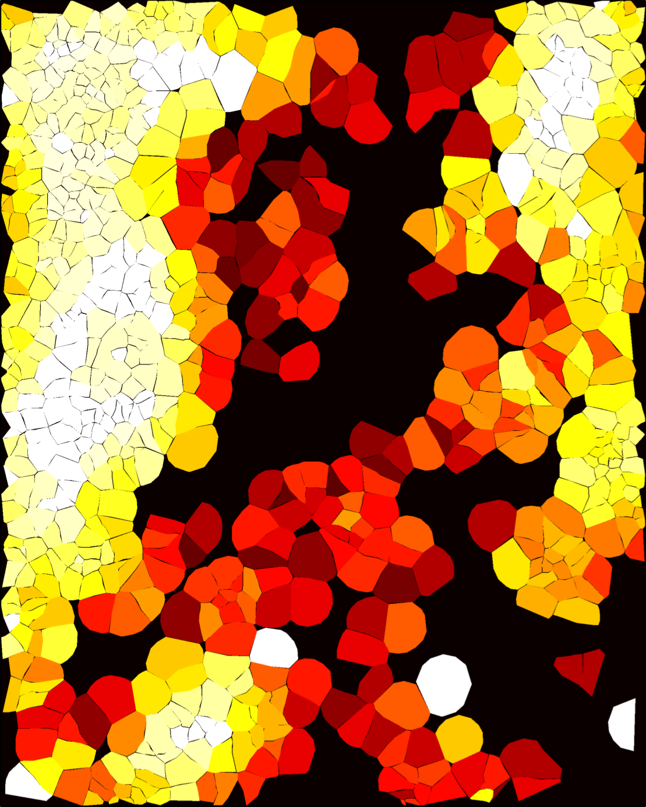

# Segmentation (cell) metrics

Glossary of all metrics used for the high-quality cell region (HQCR).

SpoQC currently computes the following QC metrics from the single cell and cell segmentation data:

- cell-area–normalized transcript counts
- control probe counts (based on Xenium control probes)
- cell-area–normalized gene counts
- cell convexity
- minimum nuclear convexity per cell (cells may contain multiple nuclei)
- number of nuclei per cell
- border score
- thinness (bubble) score
- island score
- area of overlap with other cell polygons
- number of transcripts located within the cell convex hull but not assigned to the cell (uRNAs within convex hull)
- number of low-quality transcripts (QV < 20)
- doublet metrics using [ovrl.py](https://github.com/HiDiHlabs/ovrl.py): doublet distance, doublet density and the doublet density divided by distance (ddd)
- invalid cell and nucleus geometries

All metrics in `spoqc/metrics/hqcr/` are used for the HQCR analysis (see [Contribute](contribute.md)).

## Doublet metrics

Doublet events (overlapping signal of different cells, e.g., vertical doublets) are detected with [ovrl.py](https://github.com/HiDiHlabs/ovrl.py) in the `doubletqc` step. The detected events are mapped back to the cells:

- `doublet_distance`: Distance of the cell centroid to the closest doublet event. If no doublet event was detected, the value is set to $100{,}000$.
- `doublet` / `wdoublet`: Whether the cell is within a distance of $10$ to a doublet event.
- `doublet_density`: Kernel density of cells close to doublet events at the position of the cell.
- `doublet_ddd`: Doublet density divided by doublet distance (relative density),

  $$
  \text{ddd} = \frac{\text{doublet density}}{\text{doublet distance}}
  $$

  The closer the ddd is to $0$, the better the quality. The ddd is used for the doublet prior.

## Invalid geometries

During data loading (steps `all` and `generalqc`) spoQC checks whether the cell and nucleus polygons are valid geometries and corrects them. Cells with an invalid cell or nucleus polygon are flagged in `wvalid_cell_geometry` and `wvalid_nucleus_geometry` ($1$ = invalid).

## Convexity

The convexity of a cell or nucleus has values in the range of $[0,1]$, where $1$ represents a fully convex polygon.

## Thinness (bubble) score

The thinness score evaluates whether a cell polygon approximates a circular “bubble” shape. It is defined as:

$$
T = \frac{4 \pi A}{P^2}
$$

where $A$ is the cell area and $P$ is the polygon perimeter (circumference). Values close to $1$ indicate a highly circular shape.

## Border score

The border score measures whether a cell is located at a physical boundary, such as the edge of the slide or the interface between tissue domains. The score takes values in $[0,\infty)$, where larger values indicate a higher likelihood of being a border cell. In our datasets, values typically range between $0$ and $7$.

**Computation:**

1. For a given cell, all neighboring cells within a circular radius are identified.
2. The log-ratio between the number of neighbors on opposite sides of the cell is calculated:

   $$
   \log_2\left(\frac{N_{\text{left}}}{N_{\text{right}}}\right)
   $$

3. Because tissue borders are not necessarily aligned with Cartesian axes, the neighborhood is rotated (using a rotation matrix) around the central cell.
4. The log-ratio is computed for multiple rotation angles between $0^\circ$ and $360^\circ$.
5. The maximum log-ratio across all orientations is defined as the border score.

## Island score

The island score measures how isolated a cell is within the tissue, identifying regions with weak connectivity, or in an extreme case, single cells.

**Computation:**

1. A *k*-d tree is constructed from cell centroids.
2. Using a fixed distance threshold, an iterative connected-component search is performed:
   - For each cell, neighboring cells within the threshold are identified.
   - Neighbors that themselves have neighbors within the threshold are recursively added to the group.
   - The process continues until the component boundary is reached.
3. Each connected component contains a certain number of cells.
4. This component size is assigned to every cell in the component and defined as its island score.

Small island scores indicate isolated or weakly connected cells, whereas large scores indicate dense tissue regions.

## HQCR priors

Each prior estimates, for every cell, the probability that the cell is of **high quality** (values in $[0,1]$, higher is better). The priors are located in `spoqc/priors/hqcr/` and are calculated in the `hqcr_ident` step. Currently the following priors are used:

| Prior | Based on | Description |
|---|---|---|
| `transcript_counts_prior` | cell-area–normalized transcript counts | Cells are clustered (Leiden) on all HQCR metrics and the clusters are grouped into three quality levels (low, mid, high) by their mean transcript counts. The probability of a cell is $1 -$ the fraction of cells within a radius of $30$ that belong to the low quality level. If the low quality level has a mean above $1$ transcript per cell, a hard threshold of $1$ is used instead. |
| `gene_counts_prior` | cell-area–normalized gene counts | Same as the transcript counts prior, using gene counts and a hard threshold of $0.5$. |
| `doublet_prior` | doublet ddd | A Gaussian on $-\log_{10}(\text{ddd})$. Cells far away from doublet events get the highest probability, cells close to doublet events a lower one. The mean is estimated with a two-component Gaussian mixture model (or set with `--doublet_prior_mean`), the standard deviation is set with `--doublet_prior_std` (default: $0.125$). |
| `control_probe_counts_prior` | negative (control) probe counts | Cells without negative probe counts get the highest probability, cells with negative probe counts a low probability. |
| `invalid_cell_geometry` | invalid cell geometry | $0$ if the cell polygon is invalid, else $1$. |
| `invalid_nucleus_geometry` | invalid nucleus geometry | $0$ if the nucleus polygon is invalid, else $1$. |

### Asymmetric evidence aggregation

The HQCR priors are combined into a single probability per cell (`good_quality_probabilities`) with an asymmetric evidence aggregation. Each prior $p_k$ of the $K$ priors is turned into a "surprise" $s_k = -\ln(p_k)$ and the surprises are aggregated with a generalized mean ($\gamma = 2$):

$$
P = \exp\left(-\left(\frac{1}{K}\sum_{k=1}^{K} s_k^{\gamma}\right)^{1/\gamma}\right)
$$

In contrast to a simple average, a single very bad prior puts a strong penalty on the cell:

- Priors $[0.90, 0.90, 0.90, 0.90, 0.90, 0.90]$ result in $P = 0.900$.
- Priors $[0.99, 0.99, 0.99, 0.99, 0.99, 0.10]$ result in $P = 0.391$.

The combined probability is then mapped to the cell polygons and refined with a Markov random field to obtain the HQCR mask.

### Cell traffic light system

In addition, each cell gets a traffic light QC level (`hqcr_traffic_light`) based on how many of the priors fail or are borderline. A prior counts as "bad" if it is below $0.3$, as "borderline" if it is between $0.3$ and $0.6$, and as "good" if it is $0.6$ or above:

- **Green:** 0 bad priors and at most 1 borderline prior.
- **Yellow:** exactly 1 bad prior, or 2 or more borderline priors.
- **Red:** 2 or more bad priors.

The traffic light levels are summarized in a dedicated page of the final report (see [Output reports](output_report.md)).
